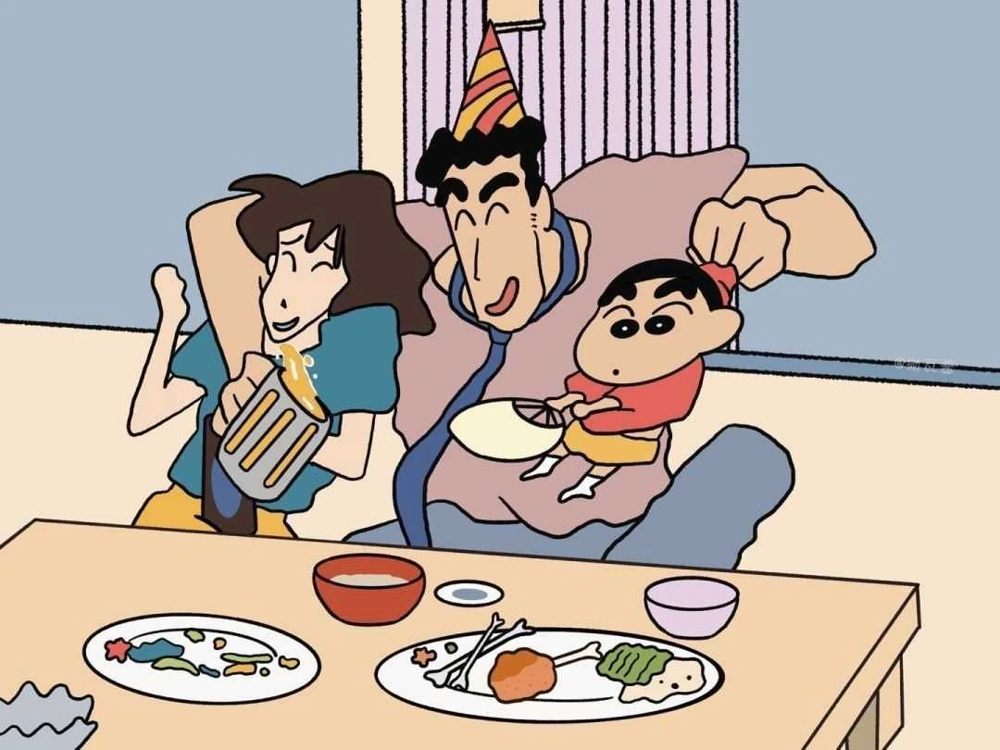
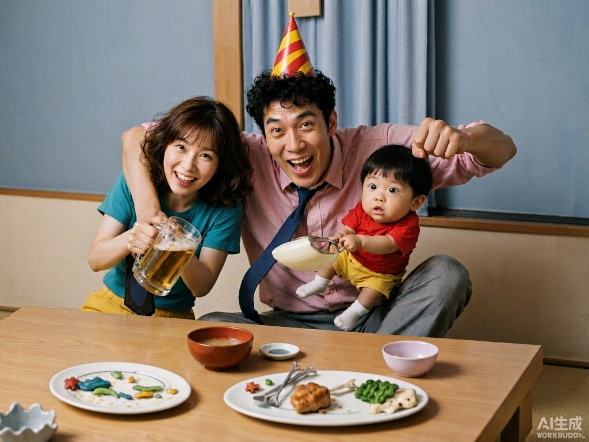

# shinchan-realistic 🖍️➡️📷

蜡笔小新截图写实化 Skill —— 将《蜡笔小新》动画截图一键转换为写实真人照片风格，适用于 [WorkBuddy](https://www.workbuddy.cn/) 等 Agent 工作台。

## 效果示例

| 动画截图（输入） | 写实化（输出） |
| :---: | :---: |
|  |  |

## 它做什么

一句话：**人物长相按参考素材锁死，画面内容按原截图锁死。**

- **人物形象**：出场角色（野原新之助/小新、野原美伢、野原向日葵/小葵、野原广志）的五官、脸型、肤色、年龄感、体型严格替换为内置的四张真人参考素材（正面/侧面/背面三视图，位于 `assets/characters/`）。
- **画面内容**：动画截图中的环境背景、人物姿态动作、衣着、发型、表情、镜头构图、光影氛围全部忠实保留——参考图中的服装仅用于锁定长相，不会被带进生成结果。
- **无参考图的角色**（小白、风间、妮妮、正男、阿呆、园长老师等）按动画外形特征直接写实化，并与野原家成员保持同一照片质感。

## 安装

### WorkBuddy（用户级技能）

把整个 `shinchan-realistic/` 文件夹复制到：

```
~/.workbuddy/skills/shinchan-realistic/
```

即：

```
shinchan-realistic/
├── SKILL.md              # 技能文档（核心，含工作流与提示词模板）
├── assets/
│   └── characters/
│       ├── xiaoxin.jpg   # 野原新之助（小新）真人三视图
│       ├── meiya.jpg     # 野原美伢真人三视图
│       ├── xiaokui.jpg   # 野原向日葵（小葵）真人三视图
│       └── guangzhi.jpg  # 野原广志真人三视图
└── examples/             # 输入/输出示例
```

重启会话后，向 Agent 上传任意蜡笔小新动画截图并说"**蜡笔小新写实风**"，技能会自动触发。（如未触发，可在消息中直接点名技能：`/shinchan-realistic`）

### 其他 Agent 平台

任何支持 Anthropic Agent Skills 规范（`SKILL.md` + YAML frontmatter + 资源目录）的平台均可直接使用：把仓库目录放入对应 skills 目录即可。

## 工作流程概览

1. **接收截图** —— 用户上传一张或多张蜡笔小新动画截图；
2. **识别角色** —— 判断画面中出现的角色，命中参考素材的直接使用，未收录的角色按动画特征写实化；
3. **图像生成** —— 原截图 + 出场角色参考图 + 中英双语提示词模板（内置在 `SKILL.md`）；
4. **校验重试** —— 核对人物一致性、画面还原度、卡通残留，偏差时定向修正（最多重试 2 次）；
5. **交付** —— 输出到 `shinchan-realistic-output/` 并展示。

> 💡 实用技巧：部分图像生成工具单次仅接受 2 张输入图。可先用 ffmpeg 把所需角色参考图纵向拼接为一张对照表再传入：
>
> ```bash
> ffmpeg -i xiaoxin.jpg -i meiya.jpg -i guangzhi.jpg \
>   -filter_complex "[0]scale=1280:-1[a];[1]scale=1280:-1[b];[2]scale=1280:-1[c];[a][b][c]vstack=inputs=3" \
>   -q:v 2 refs_combined.jpg
> ```

## 使用注意

- 生成依赖图像生成模型（如 WorkBuddy 内置 ImageGen），每次生成会消耗相应平台积分；
- 动画中夸张的头身比会按参考图真实人体比例重塑，但动作语义（指向、奔跑、搞怪姿势）会保留；
- 小新的夸张搞怪表情会转为真人可自然做出的相近神态；
- 特定集数的变装、帽子等以截图为准。

## 免责声明

本项目仅供个人学习与娱乐。蜡笔小新（クレヨンしんちゃん）及相关角色版权归 © 臼井儀人／双葉社 所有。仓库中的真人参考图与示例图由 AI 生成，请勿用于商业用途或恶意用途。

## License

MIT
